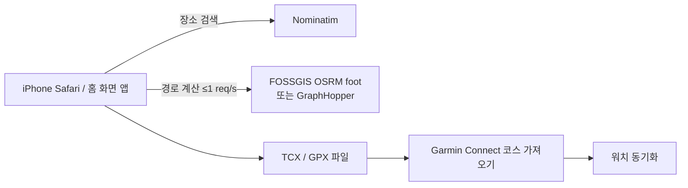
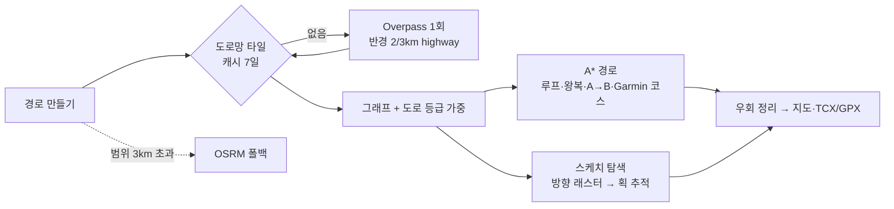
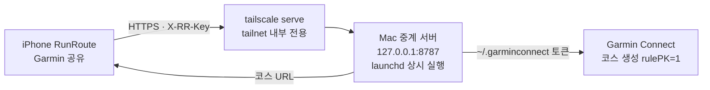

# RunRoute Planner

OSM 도보 경로 기반 러닝 코스 생성기. 단일 `index.html`, 서버 코드 없음.



## 기능
- 루프 / 반환점 왕복 / 출발→도착 + 목표 거리
- 실행 시 현재 위치로 이동, 지도 오른쪽 위 [출발 | 도착] 선택 후 탭으로 지정 (◎ = 현재 위치)
- 매 생성마다 랜덤: 방향(지정 시 ±20°), 루프 경유점 3~5개·각도·반경, 회전 방향, 우회 위치
- **불필요한 우회 제거** (기본 ON, 설정에서 끄기 가능): 막다른 가지 왕복·블록 한 바퀴 돌기 제거, 내 Garmin 코스의 랩·왕복은 보존
- 거리 자동 보정: 허용 오차 ±3%, 최대 6회 재계산 (우회 제거 후 거리 기준)
- TCX(Garmin Course 스키마, 권장) / GPX 1.1 내보내기, iOS 공유 시트
- 1km 마커, 예상 시간(페이스 입력), 마지막 입력값 기억

## 배포 (HTTPS 필수 — 현재 위치 기능이 HTTPS에서만 동작)

### A. GitHub Pages
```bash
mkdir runroute && cd runroute && cp /path/to/index.html .
git init -b main && git add index.html && git commit -m "RunRoute Planner"
gh repo create runroute --public --source=. --push
gh api -X POST repos/{owner}/runroute/pages -f "source[branch]=main" -f "source[path]=/"
gh api repos/{owner}/runroute/pages --jq .html_url   # 1~2분 후 접속
```
> 무료 플랜의 GitHub Pages는 public 저장소가 필요합니다. 코드에 비밀 정보는 없지만 GraphHopper 키는 파일에 넣지 말고 앱 설정에서 입력하세요(브라우저 localStorage 저장).

### 0. 가장 빠른 확인 (Mac)
`index.html` 다운로드 → 더블클릭 → 브라우저에서 바로 실행. 위치 권한이 거부되면 지도를 탭해 출발지 지정.
Claude 모바일 앱·iPhone 파일 앱 미리보기에서는 외부 호출이 막혀 정상 동작하지 않습니다.

### B. 로컬 테스트
```bash
cd runroute && python3 -m http.server 8080
# 같은 Wi-Fi의 iPhone에서 http://<Mac IP>:8080 (이 경우 현재 위치 기능은 동작하지 않음)
```

### iPhone
Safari로 접속 → 공유 → **홈 화면에 추가**.

## Garmin 공유 (v20부터 유일한 내보내기)
1. 결과 화면 **Garmin 공유** → Mac 릴레이가 Garmin Connect에 공개 코스로 등록 → 코스 링크 복사 팝업
2. Garmin Connect에서 **기기로 전송** → 워치 동기화 → 워치에서 내비게이션 → 코스

TCX/GPX 파일 저장 버튼은 v20에서 제거했습니다(내부 GPX 변환은 Garmin 등록에 계속 사용). Strava 공유는 추후 추가 예정.

## 외부 서비스 이용 조건
| 서비스 | 제한 | 앱 조치 |
|---|---|---|
| FOSSGIS OSRM | 초당 1회, 과도한 사용·스크래핑 금지, 출처 표기 | 1.1초 간격 강제, 재계산 최대 6회, 출처·fixthemap 링크 표기 |
| Nominatim | 초당 1회, 자동완성 금지 | Enter 시에만 검색 |
| OSM 타일 | 경량 사용, 출처 표기 | 개인용 전제 |

공개 서비스로 다수 사용자를 받을 계획이면 자체 OSRM/GraphHopper 서버 또는 유료 API로 전환해야 합니다.

## 알고리즘
- 루프: 출발점을 지나는 원 위 경유점 3개 → 반경을 실제 거리 비율로 반복 보정
- 왕복: 방위각 방향 반환점까지 편도 경로 → 반환점 거리 보정 → 역순 연결
- 출발→도착: 최단 경로 ≥ 목표면 최단 경로 표시. 아니면 중점 수직 방향 경유점 1개를 넣고 우회 폭 보정
- "다른 경로 생성": 방위각·회전 방향 변경

## 내 Garmin 코스 기반 생성 (v2)
- `courses/*.gpx` + `courses/index.json` = 내 Garmin Connect 코스 라이브러리 (Garmin MCP `download_course_gpx`로 수집)
- 생성 시 출발지에서 가장 가까운 내 코스(3km 또는 목표 거리 30% 이내, 상위 3개 중 랜덤)를 뼈대로 사용
  - 목표가 길면: 루프 코스는 추가 바퀴, 편도 코스는 끝에서 되돌아옴 (중복 구간 허용)
  - 목표가 짧으면: 코스를 따라가다 끊고 출발지로 복귀 / 반환점 왕복은 코스 위 반환
  - 출발지가 코스에서 떨어져 있으면 접근 구간 자동 연결
  - 근처 코스가 없을 때만 기존 랜덤 생성
- 결과에 "참조 코스(점선)"와 "내 코스와 겹치는 길 %" 표시
- 라이브러리는 `fetch`로 읽으므로 **로컬 서버(`python3 -m http.server 8080`)로 실행해야 로드됨** (file:// 불가)

### 라이브러리 갱신
Garmin에 새 코스를 만든 뒤, Claude에게 "가민 코스 라이브러리 갱신"을 요청하거나 GPX를 `courses/`에 넣고:
```bash
cd runroute && python3 build_course_index.py
```

## 페이스 입력
숫자만 입력: `710` → `7:10`, `530` → `5:30`, `1005` → `10:05` (마지막 입력값 기억)

## v3 변경 (2026-10-24)
### U턴 최소화
- 모든 경로 요청에 OSRM `continue_straight=true` (경유점에서 U턴 억제, OSRM 공식 API 옵션)
- 생성 후 U턴 자동 검출(±25m 내 150° 이상 방향 전환) → 원인 경유점 제거 후 재계산(최대 2회)
- 내 Garmin 코스 원본에 있는 U턴, 편도 코스 끝단 U턴은 의도된 것으로 허용
- 반환점 왕복: 반환점을 교차로에 스냅, ±3% 이내면 **길이 끝나는 교차로(T자·막다른 방향)** 우선
- 중간 U턴이 남으면 같은 코스 반대 방향 → 다음 후보 코스 순으로 자동 재시도(최대 3회)
- '다른 경로 생성' 시 직전과 같은 코스·방향을 피함

### 진행 방향 화살표
- 경로 위 250~800m 간격 흰색 화살표. 왕복 구간은 갈 때·올 때 화살표가 다른 위치에 반대 방향으로 표시

### 스케치런 (GPS 아트)
- 경로 유형 '스케치런' → 모양: 글자·숫자(0–9, A–Z, 최대 8자) / 강아지 / 고양이 / 하트 / 별
- '최대 거리' 이내(시작점까지 접근 구간 포함)로 맞춤
- 탐색 순서: 출발지 주변 0.5~2.2km 9곳에서 그릴 위치 탐색 → 회전 탐색(글자 ±20°, 그림 45° 단위) → 크기 맞추기
- 모양 일치도 = 이상적인 모양과 실제 경로가 서로 일정 거리(max(35m, 모양 크기의 7%)) 이내에 있는 비율(양방향 평균)
- 파란 점선 = 이상적인 모양, 주황 실선 = 실제 달릴 경로
- 한계: 강·운하·공원이 많은 지역은 모양이 작아지거나 일치도가 낮음 → 도로가 바둑판인 곳(예: 1·3·4군)으로 출발지를 옮기면 유리
- 경로 계산 약 10~15회 호출(초당 1회 제한) → 생성에 15초 내외 소요

### 우회 정리 (cutDetours) — 2026-10-29 추가
원인: 경유점이 골목·막다른 길·단지 안쪽에 스냅되면 엔진이 (a) 들어갔다 같은 길로 되돌아오는 가지(spur), (b) 블록을 한 바퀴 돌아 같은 교차로로 복귀하는 작은 루프를 만든다. 기존 `continue_straight=true`(경유점 U턴 금지)는 (b)를 유발.

| 단계 | 내용 |
|---|---|
| 1. 엔진 옵션 | 우회 제거 ON이면 OSRM `continue_straight=false`(U턴 허용 → 블록 돌기 대신 가지가 되어 2단계에서 제거). OFF면 기존 `true`. 스케치 모드는 기존 동작 유지 |
| 2. 자기 복귀 탐지 | `route()` 결과마다 적용: 점 i 이후 j가 12m 이내로 i(점 또는 선분)에 복귀, 사이 길이 ≤ `min(1.2km, 경로×15%)`, 절약 ≥ 30m → i~j 삭제 |
| 3. 내 코스 보호 | Garmin 코스 기반 생성(`genRef`) 중에는 잘릴 구간의 60% 이상이 그 코스 트랙 25m 이내면 의도된 랩·왕복으로 보고 유지 (격자 인덱스) |
| 4. 거리 재보정 | `route()`가 정리된 거리를 반환 → `fit`/`fitAdd`/`cleanup`이 그 거리로 보정 |

검증: 합성 경로 7종 통과. `courses/` GPX 33개 — 보호 없이 돌리면 32개에서 랩·왕복이 잘리는 것을 확인 → 보호 적용 후 33/33 구조 보존, 코스 밖에 삽입한 150m 가지는 29/33 제거(나머지 4건은 삽입 위치가 같은 코스의 다른 구간 도로와 겹쳐 보존된 정상 동작).
한계: 들어간 길과 12m 넘게 떨어진 평행 도로로 나오는 우회는 탐지하지 않음. 실제 OSRM 경로로는 미검증(작업 환경에서 서버 접속 불가).
백업: 적용 전 버전 `index.v4.html`.


### 경로 색상 — 2026-10-29 변경
| 색 | 의미 |
|---|---|
| 보라 (`--route` #6d28d9 / 다크 #a78bfa) | 경로 전체(가는 길). 1km 마커도 보라 |
| 청록 (`--route-back` #0891b2 / 다크 #22d3ee) | 앞서 지난 길을 **반대 방향으로 되돌아오는** 구간. 보라 선 위에 가는 청록 선으로 겹쳐 그려 두 방향이 모두 보임 |
| 화살표 | 그 지점 구간 색으로 채움(흰 테두리) |

판정(`returnMask`): 경로를 10m 간격으로 샘플링 → 60m 이상 앞선 지점 중 15m 이내 + 진행 방향 차이 ≥ 120°인 점이 구간의 50% 이상이면 "되돌아오기". 같은 방향으로 도는 랩은 보라 유지.
백업: 색상 변경 전 `index.v5.html`.

## v6 변경 (2026-10-29) — 로컬 도로망 엔진 · 안전 도로 우선 · 스케치런 재설계



### 로컬 도로망 엔진 (기본값)
- 생성 시 주변 도로를 Overpass API에서 1회 받아 Cache API에 7일 저장(타일: 중심 0.01° 격자 + 반경 2/3km). 동네가 같으면 재요청 없음.
  Overpass 공용 서버 기준: 정기 사용 앱은 하루 약 100회·10MB 미만 권장 → 개인용 범위.
- 가장 큰 연결 도로망만 사용(끊긴 조각 도로 스냅 방지). 필요 반경이 3km를 넘는 긴 경로는 OSRM으로 자동 전환.
- 설정 → 엔진에서 OSRM/GraphHopper로 되돌릴 수 있음.

### 안전 도로 우선 (지도 색 = OSM 도로 등급)
| 지도 색 | 등급 | 비용 배수 |
|---|---|---|
| 흰색 | residential · living_street · unclassified · tertiary | 1.0 ~ 1.05 |
| 빨간 점선 | footway · path · pedestrian | 1.0 |
| 회색 | service | 1.08 |
| 노랑 | secondary | 1.3 |
| 주황 | primary | 1.6 |
| 진한 주황 | trunk | 2.2 |
"무조건"이 아니라 비용 배수: primary 1.6이면 작은 길 우회가 1.6배 이하로 길 때만 작은 길 선택. 결과 안내에 "큰길(노랑·주황) N%" 표시.
실측(푸미흥, 같은 두 지점): 가중 없음 3.68km·큰길 24% → 가중 4.10km·큰길 2%.

### 스케치런 v2
1. 출발→스케치 시작, 스케치 끝→출발은 **거리로만** 계산(회색 점선). 전체 ≤ 최대 거리.
2. 도로 래스터(12m)에 **도로 방향(22.5° 8칸)** 저장 → 획과 나란한(±22.5°) 도로가 있는 배치만 점수(가로지르는 골목은 0점).
3. 반경 내 중심(80m 간격) × 크기 6단계 × 각도(±25°) 수만 개 배치를 채점 → 크기별 상위 5개를 실제 추적.
4. 추적: 획 꼭짓점만 도로 노드에 스냅, 획 사이는 "획 직선과의 거리"를 비용으로 A* → 도로 위에서만, 획에 붙어서.
5. 최종 선택 = 양방향 일치도(모양 위 점이 경로 근처 & 경로 위 점이 모양 근처, 허용 오차 = 글자 높이 6%·최소 20m) + 크기 + 똑바로 선 배치 우대.
6. 글자는 모두 밑줄(y=0)에서 시작·끝(자기 획 되짚기) → 글자 사이 연결선이 대각선이 아닌 밑줄.
7. 글자 높이 최소 300m(블록 약 3개). 최대 거리로 불가능하면 필요한 거리를 안내.
8. 일치도 ≥80% 잘 맞음 / 68~80% 대략 / <68% "알아보기 어려움" 안내.

한계(실측): 바둑판 도로에서는 대각선 획(V·W·X·K·M·N·Z 등)이 계단·사각형으로 바뀜. 남북 골목은 촘촘하고 동서 도로가 적은 푸미흥에서는 LOVE 10km 일치도 56~71%(위치에 따라), HI 6km 81~87%.
테스트: `_test/`(Overpass 실데이터, Node 하네스, 그림) — GitHub 동기화 제외.
백업: `index.v6.html`(v6 적용 전).

## v7 변경 (2026-10-29) — 흰 도로 우선 · 주황 도로는 건널목에서만 횡단

| 규칙 | 구현 |
|---|---|
| 흰 도로 우선 | 비용 배수: 흰 도로·보행로 1.0, 노랑(secondary) 1.8, 주황 primary 4 · trunk 6 |
| 주황 도로 횡단 | Overpass로 `highway=crossing`·`highway=traffic_signals` 노드와 `footway=crossing` 길을 함께 받음. 그 외 지점에서 옆길→주황 도로 노드로 들어가면 +1200m 환산 벌점 → 건널목으로 우회. 건널목이 아예 없으면 최후 수단으로 허용하고 지도에 ⚠ 표시 |
| 후보 비교 | 로컬 엔진이면 방향을 바꾼 후보 최대 4개 → 점수 = 주황×3 + 노랑 + 무단횡단×0.03 + 거리오차 초과분×4 최소 선택 (깨끗하면 1개로 종료) |
| 결과 안내 | "주황 N% · 노랑 M% · 건널목 표시 없는 횡단 K곳" |
| Overpass 혼잡 | 서버 2곳(overpass-api.de → overpass.private.coffee) × 재시도(0/2/6초). 캐시 키 v2(건널목 포함) |

실측(푸미흥, OSM 건널목·신호등 노드 1,330개, 그중 주황 도로 위 128개):
- 점대점 7구간 가중치 조합 비교: 가중 없음 주황 40%·무단횡단 23 → 채택(1200/4/6) 주황 5.9%·9, 거리 +31%. 벌점 2500은 무단횡단 6이지만 건널목까지 큰길을 걷게 돼 주황 12%.
- 앱(브라우저) 루프 8km×6·5km×4·왕복 6km×4: 주황 0~2%, 노랑 0%, 건널목 표시 없는 횡단 0~2곳, 생성 0.1~0.8초.
한계: OSM에 건널목이 표시되지 않은 실제 건널목은 알 수 없음(⚠로 표시되는 곳 상당수가 이 경우일 수 있음).
백업: `index.v7.html`(v7 적용 전).

## v8 변경 (2026-10-29) — 동네 골목 루프 (기본)
경로 스타일(루프·출발→도착): **동네 골목**(기본) / 넓게 한 바퀴(기존).
- 끝점(루프=출발지)까지 남은 최단거리 장(場)을 예산으로, 출발지 근처 흰 골목을 훑는 보행 경로를 무작위 40회 생성 → 채점 선택.
- 이동 규칙: 안 지나간 길 우선 · 흰 도로 우선 · 반경 `clamp(목표/12, 350~1500m)` 밖 감점 · 즉시 U턴·재방문 교차로 감점 · 직진 약간 우대.
- 막다른 가지: 허용 그래프(건널목 없는 주황 도로 노드 제외)의 2-core 밖 노드 → 진입 감점(들어갔다 되돌아오는 꼬리 방지).
- 주황 도로: 따라 걷기 금지(45m 이하 연결부 제외), 건널목·신호등 노드에서만 가로지르기.
- 채점 = 거리오차×6 + (1-새 길 비율)×1.5 + (1-흰 도로 비율)×2 + 반경 초과 + U턴×0.12. 오차 5% 초과 시 기존 방식으로 대체.
- 경로 스타일이 동네 골목이면 "내 Garmin 코스 기반"보다 우선.
실측(푸미흥, 브라우저): 5·8·12km 루프 9회 — 거리 오차 ±1%, 흰 도로 100%, 주황·노랑 0%, 건널목 표시 없는 횡단 0, 출발지 반경 0.4~1.3km, 0.1~0.8초.
백업: `index.v8.html`(v8 적용 전).

## v9 변경 (2026-10-29) — 동네 골목 루프: 꼬불꼬불 → 긴 직선 도로
사용자 예시(빨간 선)와 이전 결과(보라)의 차이 → 반영:
| 빨간 선 | 반영 |
|---|---|
| 긴 주거지 도로를 끝까지 직진, 끝에서만 꺾음 | 30m 뒤 기준 진행방향에서 20° 이상 꺾으면 큰 감점(로터리 빙빙 도는 것도 차단) + 최종 채점에 1km당 꺾는 횟수 |
| 이름 있는 주거지 도로 위주 | 공원 산책로·단지 안 보행로·서비스 도로 감점(`footway·path·service` 1.6, `pedestrian` 0.6, 주거지 도로 0) |
| 같은 직선 도로를 오가는 직사각형 바퀴 허용 | "새 길" 우선 가중을 크게 낮춤 |
실측(S = Nguyễn Cao 남쪽, 5회 평균): 꺾는 곳/km 5km 4.6→1.3, 8km 4.3→1.5. 앱 8km 루프: 꺾는 곳 9~12회, 흰 도로 100%, 주황·노랑 0%, 오차 ±1%.
백업: `index.v9.html`.

## v10 변경 (2026-10-29) — 선호 경로(달리기 좋은 곳) 반드시 포함 (10km 이상)
- **기본 선호 경로**: 사용자 스크린샷의 빨간 선을 지도 좌표로 변환해 내장(`PREF_SEED`, 1,146점).
  정합 방법: 스크린샷의 주황·노랑 큰길 픽셀을 OSM primary/trunk/secondary와 맞춤 → 5.0 m/px, 주황 85%·노랑 91% 일치. 빨간 선은 90%가 도로 30m 이내. 검증 그림 `_test/pref_overlay.png`.
- **선호 도로** = 선호 점 25m 이내 흰·노랑 도로(주황 제외). **선호 조각** = 500m 칸 단위(150m 미만 제외).
- **동네 골목 + 목표 10km 이상**: 출발지에서 가까운 조각부터 이어서, (이동 + 조각 60% + 귀환) ≤ 목표×95% 인 만큼 반드시 포함.
  보행 규칙: 현재 목표 조각으로 끌림(거리장), 선호 도로 처음 지날 때 +5, 선호 도로의 굽은 길은 꺾기 감점 완화, 도착 후 60% 달렸거나 선호 도로를 150m 벗어나면 다음 조각.
  10km 미만은 근처 선호 도로 가산만.
- **편집**: "선호 경로" 패널 — 지도에 표시 / 기본 선호 경로 사용 / 지도에 그리기(손가락으로 긋기, 그리는 동안 지도 고정) / 마지막 획 취소 / 내 획 지우기. 브라우저 저장(localStorage `rr.pref`).
실측(S = Nguyễn Cao 남쪽): 8km 선호 2%(포함 안 함) · 10km 34~39% · 12km 36% · 15km 44~50% · 20km 54%, 모두 흰 도로 100%·주황 0%.
한계: 북쪽 Hưng Thái 구간은 응우옌반린(주황) 건너편이라 건널목 데이터가 있는 지점으로만 건너므로 가까운 동쪽 구간이 먼저 채택됨. 선호 도로를 왕복하는 구간(청록)이 생길 수 있음.
백업: `index.v10.html`.

## v11 변경 (2026-10-29) — "Garmin 공유": 공개 코스 등록 + 링크 팝업 (개인용, Mac 중계)


- 공식 Courses API는 승인된 사업자 개발자 전용 → 개인용으로 Mac 중계 서버가 garmin_mcp와 같은 비공식 경로(`/course-service/course/import` → `/course-service/course`) 사용.
- 공개 범위: `rulePK=1`로 생성 후 재조회해 확인(garmin_mcp는 2=비공개로 사용). 1=공개는 공식 문서 미확인 → 로그아웃 상태에서 링크로 1회 확인 권장.
- 보안: 127.0.0.1 바인딩, tailnet 내부에서만 HTTPS, 헤더 키 `~/.runroute_relay_key`(600), CORS는 `https://hongseonghun.github.io`만 허용.
- 파일: `relay/garmin_relay.py`(→ `~/.runroute/`), `relay/com.runroute.relay.plist`(→ `~/Library/LaunchAgents/`), 로그 `~/.runroute/relay.log`.
- 앱 설정: 경로 엔진 설정 → Garmin 중계 주소(`https://<mac>.<tailnet>.ts.net`) · 중계 키. 미설정 시 기존 TCX 파일 공유로 대체.

운영 명령(Mac):
```bash
launchctl print gui/$(id -u)/com.runroute.relay | grep state      # 상태
launchctl kickstart -k gui/$(id -u)/com.runroute.relay             # 재시작
tail -f ~/.runroute/relay.log                                      # 로그
tailscale serve --bg 8787 && tailscale serve status                # HTTPS 노출(관리 화면에서 Serve 허용 필요)
cat ~/.runroute_relay_key | pbcopy                                 # 키 복사(유니버설 클립보드로 iPhone에 붙여넣기)
```
> ⚠️ 중지: `launchctl bootout gui/$(id -u)/com.runroute.relay` · `tailscale serve reset` (실행 전 영향 확인 — 공유 기능이 즉시 중단됨)
백업: `index.v11.html`.

## v14 변경 (2026-10-29) — 되짚기(왔다갔다) 제거
문제: Garmin 코스 527339106(A2B 15km)에서 5.1km(34%)를 지나온 길 또는 왕복 차로가 따로 그려진 평행 차로를 반대로 되짚음, 꺾는 곳 4.1회/km.
- 30m 격자에 진행 방향(45° 8칸) 기록 → 같은 길 반대 방향 −8, 평행 차로 반대 방향(겹침 비율 비례) −5. 같은 방향 바퀴 반복은 허용 유지.
- 귀환 구간을 단순 최단경로 대신 "되짚기 비용 가산 A*"로 계산(여유 12% 확보 후 귀환 시작).
- 막다른 가지 감점을 선호 도로에도 적용(선호 도로에 끌려 들어갔다 되돌아 나오는 것 방지).
- 최종 채점에 되짚기 비율 ×12.
실측(같은 출발·도착, 15km 4회): 되짚기 5.1km → 1.0~1.7km, 꺾는 곳 4.1 → 2.9~3.2회/km. 8km 루프: 되짚기 0.03~0.3km.
백업: `index.v14.html`.

## v16 변경 (2026-10-29) — 통행 불가(공사) 구간 무조건 제외
`BLOCKS` 상수(코드 내) — 그래프 생성 시 해당 길을 차단: A*·동네 골목 루프·귀환·스케치·선호 경로 계산·도로 래스터·스냅 대상에서 모두 제외.
| 구간 | 방식 |
|---|---|
| 호 반응우엣(Crescent Lake) 동쪽 호숫가 — Tôn Dật Tiên 호숫가 구간(OSM 1177152104·556396333)과 산책로 | 선 기준 35m 이내 모든 길 |
| Starlight Bridge(Cầu Ánh Sao 70560504)·남쪽 보행로(1162025864·165272299) | 선 기준 20m 이내 모든 길 |
| Crescent Lake Park 산책로 | 다각형 안 footway·path·pedestrian·steps·cycleway·track (차도 유지) |
검증: 차단 330구간·4.6km. 인근 출발 4곳 × 5·8·10·12·15km × 3회 + 호수 횡단 점대점 2건 = 62개 경로, 차단 구간 사용 0. 확인 그림 `_test/blk.png`.
한계: 3km 타일 밖으로 나가 OSRM으로 자동 전환되는 계산에는 적용되지 않음(이 구간은 출발지 3km 이내라 로컬 엔진으로 계산됨).
공사가 끝나면 `BLOCKS`에서 해당 항목 삭제.
백업: `index.v16.html`.

## v17 변경 (2026-10-29) — 우선 선호 경로(북쪽 고리) 8km 이상 포함
- 사용자 두 번째 표시(Nguyễn Cao 북쪽 → 응우옌반린 횡단 → 운하변·Nguyễn Đổng Chi → Hưng Thái 북쪽 / 병원 앞 → Tân Mỹ 재횡단)를 같은 정합 방식(5.0 m/px, 주황 83%·노랑 90%)으로 변환 → `PREF_PRIO`(434점), 확인 그림 `_test/prio_overlay.png`.
- 선택 순서: 8km 이상이면 **우선 선호 조각부터** 가까운 순으로 → 거리가 남으면(10km 이상) 일반 선호 조각.
- 횡단: 응우옌반린은 남·북 차로가 갈라져 있어 선이 한쪽 차로에서 시작해도 반대 차로까지 건너야 함 → 우선 선 120m 이내 주황 도로 교차로 노드는 사용자 지정 횡단으로 허용. (이전: 남쪽 차로 노드가 30m 밖이라 북쪽 전체가 도달 불가)
- 거리 맞춤: 선호 조각 계획 예산을 목표의 82%로(이동·귀환 여유), 오차 3% 초과 시 내부 목표를 보정해 30회 재생성, 동네 골목 채택 기준 오차 8%.
실측(S, 앱): 8km 8.09·선호 42% · 10km 10.14·선호 43%(S→Nguyễn Cao 북→운하변→Nguyễn Đổng Chi→Tân Mỹ 재횡단→S) · 12km 12.54·선호 44%. 흰 도로 98~100%.
한계: 8~10km에서 Nguyễn Cao를 왕복하는 경우 같은 길 되짚기가 20~30% 생길 수 있음(응우옌반린 횡단 지점이 제한적).
백업: `index.v17.html`.

## v18 변경 (2026-10-29) — 통행 불가 구간: 외부 엔진(OSRM·GraphHopper) 결과에도 강제 적용
문제: v16 차단은 로컬 도로망에만 적용 → 3km 타일을 벗어난 30km 출발→도착(OSRM)에서 호 반응우엣 호숫가를 지나감.
- `route()` = 로컬이면 차단된 그래프로 계산, 아니면 `routeNet()`(OSRM/GH) 결과를 `avoidBlocks()`로 검사.
- `blockHit()`: 좌표 기준 — 선 차단은 r+5m 이내, 다각형 차단은 안쪽(외부 엔진은 도로 종류를 모르므로 보수적, 단 로컬 도로망에서 막히지 않은 길로 확인되면 통과).
- 통과 시: 앞뒤 250m 지점 P·Q, 차단 구역 둘레(반경+300m) 12개 우회 후보 중 가까운 순 6개로 P→우회→Q 재계산, 최대 4회. 실패하면 경로를 내지 않고 오류.
- `generate()` 마지막에 모든 방식(루프·왕복·A→B·Garmin 코스·스케치)의 최종 경로를 다시 검사.
- Overpass 대체 서버에 VK Maps 인스턴스 추가(3곳).
실측(Mac, 실제 OSRM): 호수 서↔동 1.82km·북서↔남동 1.77→1.91km — 원본은 공사 구간 통과, 수정 후 통과 0.
백업: `index.v18.html`.

## v19 변경 (2026-10-29) — 달리기 좋은 통과 구역(호치민 마라톤 코스: 1군 강변·Thủ Thiêm)
- **통과하는 경우에만**: 출발→도착 최단 경로가 구역을 지나고 남는 거리(목표−최단) ≥ 1km 이면, 남는 거리를 구역 안에서 소비.
  구역 밖은 최단 경로, 구역 진입~이탈 구간만 구역 도로망(Overpass로 별도 로드)의 동네 경로(genWalk, 지정 도로 우선·강제 포함)로 교체. 오차 6% 초과면 기존 방식.
- 구역 안 지정 도로는 큰길이어도 흰 도로와 같은 비용·횡단 허용, 우선 선호 도로로 포함.
- 지정 도로(공식 자료 기준 코스 요소): Lê Duẩn·Nguyễn Bỉnh Khiêm(출발, Thảo Cầm Viên)·Công xã Paris·Đồng Khởi·Nguyễn Huệ·Lê Lợi·Tôn Đức Thắng·Hàm Nghi·Võ Văn Kiệt·Cầu Ba Son·Cầu Thủ Thiêm·Mai Chí Thọ·Tố Hữu·Trần Bạch Đằng·Nguyễn Cơ Thạch. 연도별 세부 코스는 변동.
- ⚠️ 구역 경계 `box`는 근사값(Overpass 3개 인스턴스 장애로 실좌표 미검증) → 회복 후 검증 예정.
- 동작 검증(푸미흥 데이터에 가상 구역): 최단 3.83km에서 목표 6km → 5.88km(구역 안 4.35km) · 8km → 7.83km(구역 안 6.31km, 지정 도로 43%) · 10km → 구역이 작아 -8.8%라 기존 방식으로 대체. 원래 지역 도로망 가중치 불변.
- 루프는 대상 아님(출발→도착만).
백업: `index.v19.html`.

## v20 변경 (2026-10-29) — 짧은 우회 금지 + 도착 후 직진 연장, 저장 버튼 정리
- 결과 화면: TCX/GPX 저장 버튼 제거, **Garmin 공유** 하나만 표시(Strava 공유는 추후).
- `cleanSpurs`: 스케치 제외 모든 모드(반환점 왕복은 반환점 보호를 위해 제외)에서 30m 이내로 되돌아오는 800m(또는 전체 30%) 이하 구간 중
  '접힌' 구간(10m 간격 대칭 지점이 45m 이내로 85% 이상 겹침 = 막다른 꼬리, 인터체인지 갈고리, 왕복 차로 넘나들기)을 잘라내고 로컬 그래프 최단 연결로 대체. 블록 한 바퀴 같은 정상 루프는 유지.
- `extendFinish`: 잘라내거나 원래 모자란 거리는 경로 중간이 아니라 **도착 지점에서** 채움. 도착점에서 deficit/2 떨어진 지점 중 직선도(직선거리/도로거리)가 가장 높은 곳까지 같은 길로 왕복.
  흰 도로 → 노랑 허용 → (그래도 없으면) 모든 도로 순으로 완화, 공사 구간은 항상 제외. 지도에서는 돌아오는 구간이 청록색으로 표시.
- 측정(PMH 실데이터, 하네스): 루프 5~15km 접힌 우회 1~12곳 → 0곳, 최종 오차 대부분 ±1% 이내. E2E: 출발→도착 6/10km 오차 0.0~-0.5%, 도착 후 1.1km 직진 왕복.
- 한계: 경로가 목표보다 긴 경우(초과)는 이 단계에서 줄이지 않음. 백업: index.v20.html(이전), index.v21.html(이번).

## v21 변경 (2026-10-29) — 마라톤 구역 실데이터 검증·보정
- Overpass 4분할 수집(_test/zq1~4.json, 9,309 ways)으로 지정 도로 검증: 15개 중 14개 이름 일치. `Công xã Paris` → 실제 OSM 이름 `Công trường Công xã Paris`로 수정, 변형 `Đường Lê Duẩn` 추가.
- 구역 box를 도로 실제 범위에 맞춰 [10.764,106.695,10.794,106.73]으로 조정.
- **보행 불가 도로 제외(전체 그래프)**: `motorroad=yes`(Mai Chí Thọ 본선 등)와 차량 터널(Thủ Thiêm 터널 `tunnel=yes`)은 그래프에서 제외. 보행자 터널/지하도는 유지.
- `zoneRoute`: 구역 안은 '동네 골목' 랜덤워크 대신, 지정 도로 양 끝(앵커)을 예산 안에서 하나씩 끼워 넣어 지정 도로 거리를 최대화. 같은 길·반대 차로 되짚기가 120m(앵커 왕복)/200m(기존 경로) 넘는 앵커는 제외. 실패 시 기존 genWalk로 대체.
- 실데이터 시험(1군·Thủ Thiêm 그래프, 북쪽 진입→남서쪽 이탈): 지정 도로 비율 58~64%(이전 17~19%), 최종 오차 ±0.5% 이내. 구역에서 되짚기 없이 쓸 수 있는 거리는 약 12.6km까지이며, 그 이상 남는 거리는 도착 지점 직진 연장으로 채움.
- 백업: index.v22.html.

## v22 변경 (2026-10-30) — 공원 회피 · Garmin 공개 러닝 코스 참조 · Thủ Thiêm 테크콤 주로
- **공원 회피**: Overpass 질의에 `leisure=park|garden`(way·relation) 추가 → 폴리곤 안 도로 구간은 탐색 비용 ×4(`g.cm`), 동네 골목 걷기 벌점 +4. 도로 등급(wt)은 그대로라 주황/노랑 판정에 영향 없음. 사용자가 그린 선호 경로(빨간 선)는 공원 안이어도 예외. PMH 실측(선호 경로 제외 공원 안 비율): 8km 4.4%→0.9%, 10km 1.2%→0%, 12km 0.9%→0%.
- **Garmin 공개 러닝 코스 참조**: 중계 `GET /popular?s&w&n&e&max` 추가. Garmin Connect 코스 탐색과 같은 `/course-service/course/search`(호출당 50개)를 4분할 반복(최대 85회)해 범위 안 공개 코스를 모으고, 러닝 종류만·내 코스 제외 → 상세 geoPoints(20m 간격으로 축약)를 `~/.runroute/gcache/`에 1회만 저장(0.4s 간격 백그라운드 수집). 앱은 25m 격자에 코스 수를 세어 흰 도로 탐색 비용을 최대 35% 낮춤. PMH 범위: 러닝 공개 코스 374개 확인. 참고: Garmin 비공개(문서화되지 않은) 웹 API이므로 예고 없이 바뀔 수 있음.
- **Thủ Thiêm 테크콤 주로**: RUN_ZONES 를 2개로 분리. Thủ Thiêm 구역 = 2025-12-07 HCMC International Marathon(Techcombank) 공식 풀코스 지도의 Thủ Thiêm 구간 도로(Cầu Thủ Thiêm, Nguyễn Cơ Thạch, Nguyễn Thiện Thành, Cầu Ba Son, Trần Bạch Đằng=Đại lộ Vòng Cung, Đường N12, Mai Chí Thọ(보행 가능 구간), Bùi Thiện Ngộ). 주로가 아닌 Tố Hữu는 제외. 이 구역을 지나는 경우에만 적용. 실데이터 시험: 주로 비율 80~85%.
- 백업: index.v23.html.

## v23 변경 (2026-10-30) — 주변 공개 코스 자동 참조(충분하면 생략) · 화면 문구 '달리기 맵'
- 맵을 그릴 때마다 출발·도착 주변(로컬 도로망 범위) 공개 러닝 코스를 중계에 요청. 중계는 그 범위에 이미 저장된 코스가 40개 이상이면 Garmin 검색을 생략하고 저장분만 반환(실측 0.2초, PMH 361개). 부족하면 검색 후 백그라운드 수집(신규 지역 실측 2.9초).
- 화면 문구: '경로' → '달리기 맵/길' (경로 만들기 → 달리기 맵 그리기, 다른 경로 생성 → 다른 맵 그리기, 경로 유형 → 달리기 유형, 경로 스타일 → 맵 스타일, 선호 경로 → 좋아하는 길 등).
- 백업: index.v24.html.

## v24 변경 (2026-10-30) — 단지 내부길·공원길 제외, 겹치는 길 한 줄, 도착 꼬리 정리
- 주차 통로·진입로(service=parking_aisle|driveway|drive-through|emergency_access) 그래프 제외, 이름 없는 service 도로 비용 ×3, 동네 골목 걷기 벌점 3.
- 공원·정원 안 길: 회피 → **제외**(blk). 사용자가 그린 좋아하는 길과 겹치는 부분만 예외. PMH 실측 공원 안 비율 0%.
- Garmin 공개 코스 우대는 실제 길(residential·living_street·unclassified·tertiary·pedestrian)에만 적용(단지·산책로·주차 통로 제외).
- `unifyOverlap`: 나중 구간이 앞선 선과 30m 이내로 40m 이상 나란히 가면 앞선 선 좌표로 대체 → 같은 길은 선 하나(반대 차로·반대편 인도 포함). 사용자 코스 527474662 에서 4곳 통일.
- 짧은 꼬리 기준 60m→30m, 같은 교차로(15m 이내) 데이터 끊김은 직선 연결.
- 출발·도착 지점은 실제 길(차도·생활도로) 노드에 붙임(`streetNode`), 도착 직전 60m 안 50° 넘는 꺾임 꼬리 제거(`trimTail`) 후 직진 연장.
- 화면 문구에서 베트남어 제거(공사 구간·마라톤 구역 이름 한국어 표기).
- 백업: index.v25.html.

## v25 변경 (2026-10-30) — 공개 코스가 많이 겹치는 길 우대
- 친구 여부와 상관없이 공개 러닝 코스가 **서로 다른 코스 3개 이상** 지나간 칸(약 27m 격자)만 '인기 구간'으로 우대. 겹침이 많을수록 비용↓(최대 45%↓). 실제 길(동네길·차도)만 적용.
- 중계 `/popular?...&mode=heat`: 코스 선 대신 인기 칸만 반환(PMH 범위 1.6MB → 78KB, 0.26초).
- 중계 백그라운드 수집: 시작 1분 뒤, 이후 하루 한 번 호치민 전역 공개 러닝 코스를 검색(최대 800회, 0.2초 간격)하고 새 코스 상세를 하루 최대 1,500개(0.5초 간격) 저장.
- PMH 실측(인기 구간 3개↑ 비율, 루프): 5km 49%→61%, 8km 81%→82%, 10km 73%→75%, 12km 72%→75%. 거리 오차 변화 없음(0.2~0.7%).
- 백업: index.v26.html.

## v26 변경 (2026-10-30) — 안전 우선: 큰길 횡단 최소화 · 아파트 단지 내부 제외 · 직진 우선
- **아파트 단지 내부 길 제외**: Overpass에 `landuse=residential`+`residential=apartments`(또는 이름 Chung cư/Căn hộ) 폴리곤 추가 → 폴리곤 안의 이름 없는 통로·보행로·service 는 맵에서 제외(PMH 단지 59곳, 747구간). 이름 있는 공용 도로는 유지.
- **분리 차로 큰길 횡단 비용**: 같은 이름 큰길(노랑·주황) 두 차로 사이를 잇는 60m 이하 구간 = 횡단 → 탐색 비용 +300m, 동네 골목 걷기 −20점. PMH 40개 코스 실측: '큰길 건너 그 길 따라가다 다시 건넘' 0.07→0.00회/코스.
- **큰길은 건너기만**: 주황 도로 짧은 구간을 이어 붙여 큰길 위를 달리던 경우 금지(연속 주황 구간 진입 불가).
- **직진 우선 강화**: 꺾을 때 벌점 3.5→5, 같은 이름 길로 곧게 이어가면 +2, 출발지 반경 이탈 벌점 완화(r/120→r/250). 1km당 꺾는 횟수 4.0→3.4.
- 이름 없는 service 비용 ×3 → ×1.5(큰길 옆 측도는 남겨 둠).
- 도착 직진 연장이 한 번에 모자라면 한 번 더 연장(최대 2회).
- 백업: index.v27.html.

## v27 변경 (2026-10-30) — 지도 확대·축소 반응
- 원인 조사: 경로 그리기 자체는 병목 아님(모바일 CPU 4배 감속 측정에서 확대/축소 1회 ≈ 0.3초 = Leaflet 애니메이션, SVG/캔버스 차이 없음).
  Mac(집 네트워크)에서 `tile.openstreetmap.org` 접속 시 TLS 연결 재설정(curl 35, 3/3회) 확인 → 타일 로딩 실패·지연이 체감 원인으로 판단.
- 타일 캐시 Service Worker(`sw.js`): OSM 타일을 휴대폰에 7일·최대 3,000장 보관(cache-first), Leaflet 라이브러리도 캐시.
- OSM 타일이 10초 안에 6번 넘게 실패(성공보다 많음)하면 OSM 프랑스 타일로 자동 전환(하루 뒤 다시 기본 서버 시도).
- 지도 옵션: 캔버스 렌더러, keepBuffer 4, 확대 중 타일 갱신 안 함, 휠 감도 완화.
- 백업: index.v28.html.

## v28 변경 (2026-10-30) — 바탕 지도를 Mac에 보관, 휴대폰은 Mac에서 가져오기(위치 기반)
- OSMF 타일 정책상 tile.openstreetmap.org 타일을 미리 받아 두거나(오프라인 저장) 캐시 프록시로 보관하는 것은 금지/비권장 → OSM 표준 타일을 Mac에 쌓지 않음. `sw.js`도 OSM 타일 저장을 빼고 라이브러리만 캐시.
- 대신 Protomaps 일일 빌드(OpenStreetMap 데이터, ODbL)에서 지역만 잘라 Mac `~/.runroute/maps/*.pmtiles`로 보관(`pmtiles extract`). 호치민(10.65~10.90, 106.55~106.85, z0~15) = 14.3MB, 944조각.
- 중계: `/maps/index.json`(지역 목록), `/maps/<파일>.pmtiles`(Range 지원·CORS), `/maps/ensure?lat&lon`(키 필요, 그 위치 ±0.15° 지역을 백그라운드로 새로 저장).
- 앱: 화면 중심이 Mac 보관 지역 안이면 protomaps-leaflet 5.1.0으로 벡터 지도 표시(한국어 이름 우선), 밖이면 기존 래스터 지도 + Mac에 그 지역 저장 요청(10분에 1번). 중계에 못 닿으면 래스터 유지.
- 측정: 테일넷 Range 16KB 0.02초. E2E(z16 화면): Range 6회 153KB.
- 백업: index.v29.html.

## v29 변경 (2026-10-30) — 스케치런: 모양 우선 · 장소 찾기 · 디지털 숫자
- 출발지 고정 없음: 기준점(출발지 지정 시 그곳, 아니면 지도 중심)에서 '찾을 범위'(3/6/10km) 안을 반경 3km 도로망 단위(1/5/9개 지역)로 훑어 모양이 가장 잘 나오는 장소·크기·각도 탐색.
- 거리 = 모양 길이만(출발점까지 이동 제외). 크기는 '모양 거리'의 0.85~1.5배 범위에서 모양 일치도 우선(거리 차이는 10% 넘는 부분만 약하게 감점).
- 회전 후보에 그 지역 도로망의 우세 방향(바둑판 각도) 추가.
- 서로 800m 이상 떨어진 후보 3곳 버튼으로 비교, S/F 표시.
- 디지털 숫자(전자시계 7획: 1·7도 가로·세로 획만), 최대 6자리.
- PMH 실데이터(반경 3km, 1지역): "7" 100%, "5" 94%, "42" 79%, "815" 72%, "1030" 68%. E2E "42" 반경 6km 7초.
- 한계: 스케치 경로는 모양을 우선해 주황 도로를 지날 수 있음(정보란에 비율·횡단 표시).
- 백업: index.v30.html.

## v30 변경 (2026-10-30) — 맵 그리는 중 진행률 화면
- 화면 가운데 진행률(%) 카드: 달리는 아이콘, 진행 막대, 현재 단계, 앱 규칙 안내 한 줄.
- 단계별 구간: 도로망 불러오기 0~20%, Garmin 공개 코스 참조 20~25%, 맵 계산 25~88%(동네 골목 시도 횟수, 스케치 지역·후보 수 기준), 정리 88~98%, 끝나면 100%. 멈춰 보이지 않게 0.4초마다 조금씩 증가.
- 동네 골목 계산을 제너레이터로 바꿔 50ms마다 화면 갱신(`genWalkAsync`), 결과는 이전과 동일(동기 `genWalk`도 유지).
- 백업: index.v31.html.

## v31 변경 (2026-10-30) — 스케치런: 거리 자동 확대 · 남는 거리는 같은 모양 반복
- 입력 거리로 알아볼 크기(글자 높이 250m·그림 300m)가 안 나오면 오류 대신 모양 거리를 자동으로 늘림(정보란 표시).
- 모양은 알아보기 좋은 크기까지만(글자 높이 900m·그림 1200m 상한) 키우고, 남는 거리는 끝→시작을 이어 같은 모양을 여러 바퀴 반복.
- PMH 실측: "7" 15km → 1바퀴 2.1km × 7바퀴 14.9km(일치 100%), "42" 21km → 7.3km × 3바퀴(89%), "1030" 3km → 5.2km로 자동 확대(77%).
- 백업: index.v32.html.

## v32 변경 (2026-10-31) — 내 러닝 기록 기준 '동네' 코스, 긴 거리는 동네 루프 반복
- 원인: 30km는 동네 골목 1회 탐색으로 못 채움(오차 −18~−38%) → 넓은 범위(OSRM) 생성으로 넘어가 처음 가는 먼 곳까지 감.
  이후 정리 단계에서 모자란 거리를 도착 후 직진 왕복으로 최대 9.5km까지 채우는 문제도 확인.
- 내 기록: 중계가 최근 12개월 내 러닝 활동 GPS 선(236회)을 Mac `~/.runroute/mine/`에 저장, 하루 한 번 새 활동 추가. `/mine`(키 필요)은 칸별 '내가 달린 횟수'만 반환.
  기록 분석: 집 1.5km 안 출발 160회, 35km·28km·24km 장거리도 최대 반경 약 2.3km.
- 앱: 내가 2번 이상 달린 길 비용 최대 55%↓, 내가 달린 곳에서 150m 넘게 벗어나는 길 강한 감점.
- 긴 거리: 한 번에 못 채우면 동네 루프를 2~6바퀴 반복(바퀴 수 적은 것 우선, 오차 6% 안이면 채택). 출발→도착은 루프 반복 뒤 도착지로.
- 도착 후 직진 연장 상한: max(1.2km, 목표 10%). 정리 후 부족분이 이 한도를 넘으면 그 후보는 버림.
- E2E(PMH, 내 기록 적용): 10km 2바퀴·최대 반경 1.5km, 21km 6바퀴 0.7km, 30km 6바퀴 1.5km(이전: 반경 4.1km 이상).
- 백업: index.v33.html.

## v33 변경 (2026-10-31) — 긴 거리: 내가 실제로 뛴 코스들을 이어 붙이기(같은 루프 반복 대신)
- 중계 `/mine/runs`(키 필요): 출발지 1.5km 안에서 시작·끝나고 전체가 3.3km 안인 내 러닝(최근 12개월, 2~30km)을 약 80m 간격 선으로 반환. 집 기준 117개.
- 앱 `genFromMine`(8km 이상, 루프·출발→도착): 무작위 500개 조합 중 합이 목표에 맞고 서로 겹치는 길이 적은 조합 상위 4개 → 각 코스를 기록 선 30m 통로 우대 A*(약 700m 경유점)로 지금 도로망에 다시 그림(공사·공원·단지·횡단 규칙 유지). 다시 그린 길이 비율로 보정해 최대 3회 반복.
- 정리 단계: 내 기록 조합은 실제 왕복 구간을 지우지 않도록 짧은 꼬리 기준 40m, 겹친 길 통일 생략.
- 공사 구간 선(line) 판정도 도로망 위 경로는 실제 막힌 구간을 지날 때만 걸림(근처 다른 길 오판 수정).
- E2E(PMH): 10km 3개 조합 반경 1.5km, 21km 3개 조합 2.7km, 30km 3개 조합 2.5km(매번 다른 조합). 오차 −0.4~+1.5%.
- 백업: index.v34.html.

## v34 변경 (2026-10-31) — 상황에 따라: 내 코스 · 내 코스+주변 길 · 동네 골목 중 고르기
- 8km 이상 후보: ① 내 러닝 기록 조합(상위 3개) ② 내 코스 앞부분(목표 40~70%) + 나머지는 출발지 기준 동네 골목(다른 러너 인기 길·내 코스 주변 우대) ③ 동네 골목만.
- 채점: 거리 오차×4 + 같은 길 반복 비율×2.5 − (내가 달린 길·인기 길 비율)×1 + 출발지 2.8km 밖 거리 감점 → 가장 낮은 것.
- '내 코스 주변' 범위 150m → 약 330m로 넓힘(그 밖은 감점 유지).
- 정보란에 '내가 실제로 달린 코스 n개(+ 주변 길 x km)', '같은 길 반복 %', '내 길·인기 길 %' 표시.
- E2E(PMH): 10km 내 코스 1개+주변 5.9km(반복 22%), 21km 내 코스 2개(26%), 30km 내 코스 2개+주변 9.3km(32%) / 3개(36%), 최대 반경 2.7km.
- 백업: index.v35.html.
