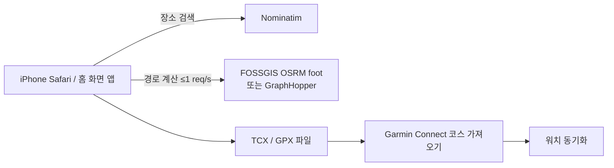

# RunRoute Planner

OSM 도보 경로 기반 러닝 코스 생성기. 단일 `index.html`, 서버 코드 없음.



## 기능
- 루프 / 반환점 왕복 / 출발→도착 + 목표 거리
- 실행 시 현재 위치로 이동, 지도 오른쪽 위 [출발 | 도착] 선택 후 탭으로 지정 (◎ = 현재 위치)
- 매 생성마다 랜덤: 방향(지정 시 ±20°), 루프 경유점 3~5개·각도·반경, 회전 방향, 우회 위치
- **불필요한 우회 제거** (기본 ON, 설정에서 끄기 가능): 막다른 가지 왕복·블록 한 바퀴 돌기 제거, 내 Garmin 코스의 랩·왕복은 보존
- 거리 자동 보정: 허용 오차 ±3%, 최대 6회 재계산 (우회 제거 후 거리 기준)
- TCX(Garmin Course 스키마, 권장) / GPX 1.1 내보내기, iOS 공유 시트
- 1km 마커, 예상 시간(페이스 입력), 마지막 입력값 기억

## 배포 (HTTPS 필수 — 현재 위치 기능이 HTTPS에서만 동작)

### A. GitHub Pages
```bash
mkdir runroute && cd runroute && cp /path/to/index.html .
git init -b main && git add index.html && git commit -m "RunRoute Planner"
gh repo create runroute --public --source=. --push
gh api -X POST repos/{owner}/runroute/pages -f "source[branch]=main" -f "source[path]=/"
gh api repos/{owner}/runroute/pages --jq .html_url   # 1~2분 후 접속
```
> 무료 플랜의 GitHub Pages는 public 저장소가 필요합니다. 코드에 비밀 정보는 없지만 GraphHopper 키는 파일에 넣지 말고 앱 설정에서 입력하세요(브라우저 localStorage 저장).

### 0. 가장 빠른 확인 (Mac)
`index.html` 다운로드 → 더블클릭 → 브라우저에서 바로 실행. 위치 권한이 거부되면 지도를 탭해 출발지 지정.
Claude 모바일 앱·iPhone 파일 앱 미리보기에서는 외부 호출이 막혀 정상 동작하지 않습니다.

### B. 로컬 테스트
```bash
cd runroute && python3 -m http.server 8080
# 같은 Wi-Fi의 iPhone에서 http://<Mac IP>:8080 (이 경우 현재 위치 기능은 동작하지 않음)
```

### iPhone
Safari로 접속 → 공유 → **홈 화면에 추가**.

## Garmin 가져오기
1. 앱에서 **TCX 저장** (iPhone은 파일 앱 → 다운로드 폴더)
2. Garmin Connect 웹 → 트레이닝 및 계획 → 코스 → 가져오기 → 파일 선택 → 저장
3. **기기로 전송** → 워치 동기화 → 워치에서 내비게이션 → 코스

GPX가 거부되면 TCX를 사용하세요. 공유 시트로 Garmin Connect 앱에 직접 넘기는 동작은 검증되지 않았습니다.

## 외부 서비스 이용 조건
| 서비스 | 제한 | 앱 조치 |
|---|---|---|
| FOSSGIS OSRM | 초당 1회, 과도한 사용·스크래핑 금지, 출처 표기 | 1.1초 간격 강제, 재계산 최대 6회, 출처·fixthemap 링크 표기 |
| Nominatim | 초당 1회, 자동완성 금지 | Enter 시에만 검색 |
| OSM 타일 | 경량 사용, 출처 표기 | 개인용 전제 |

공개 서비스로 다수 사용자를 받을 계획이면 자체 OSRM/GraphHopper 서버 또는 유료 API로 전환해야 합니다.

## 알고리즘
- 루프: 출발점을 지나는 원 위 경유점 3개 → 반경을 실제 거리 비율로 반복 보정
- 왕복: 방위각 방향 반환점까지 편도 경로 → 반환점 거리 보정 → 역순 연결
- 출발→도착: 최단 경로 ≥ 목표면 최단 경로 표시. 아니면 중점 수직 방향 경유점 1개를 넣고 우회 폭 보정
- "다른 경로 생성": 방위각·회전 방향 변경

## 내 Garmin 코스 기반 생성 (v2)
- `courses/*.gpx` + `courses/index.json` = 내 Garmin Connect 코스 라이브러리 (Garmin MCP `download_course_gpx`로 수집)
- 생성 시 출발지에서 가장 가까운 내 코스(3km 또는 목표 거리 30% 이내, 상위 3개 중 랜덤)를 뼈대로 사용
  - 목표가 길면: 루프 코스는 추가 바퀴, 편도 코스는 끝에서 되돌아옴 (중복 구간 허용)
  - 목표가 짧으면: 코스를 따라가다 끊고 출발지로 복귀 / 반환점 왕복은 코스 위 반환
  - 출발지가 코스에서 떨어져 있으면 접근 구간 자동 연결
  - 근처 코스가 없을 때만 기존 랜덤 생성
- 결과에 "참조 코스(점선)"와 "내 코스와 겹치는 길 %" 표시
- 라이브러리는 `fetch`로 읽으므로 **로컬 서버(`python3 -m http.server 8080`)로 실행해야 로드됨** (file:// 불가)

### 라이브러리 갱신
Garmin에 새 코스를 만든 뒤, Claude에게 "가민 코스 라이브러리 갱신"을 요청하거나 GPX를 `courses/`에 넣고:
```bash
cd runroute && python3 build_course_index.py
```

## 페이스 입력
숫자만 입력: `710` → `7:10`, `530` → `5:30`, `1005` → `10:05` (마지막 입력값 기억)

## v3 변경 (2026-10-24)
### U턴 최소화
- 모든 경로 요청에 OSRM `continue_straight=true` (경유점에서 U턴 억제, OSRM 공식 API 옵션)
- 생성 후 U턴 자동 검출(±25m 내 150° 이상 방향 전환) → 원인 경유점 제거 후 재계산(최대 2회)
- 내 Garmin 코스 원본에 있는 U턴, 편도 코스 끝단 U턴은 의도된 것으로 허용
- 반환점 왕복: 반환점을 교차로에 스냅, ±3% 이내면 **길이 끝나는 교차로(T자·막다른 방향)** 우선
- 중간 U턴이 남으면 같은 코스 반대 방향 → 다음 후보 코스 순으로 자동 재시도(최대 3회)
- '다른 경로 생성' 시 직전과 같은 코스·방향을 피함

### 진행 방향 화살표
- 경로 위 250~800m 간격 흰색 화살표. 왕복 구간은 갈 때·올 때 화살표가 다른 위치에 반대 방향으로 표시

### 스케치런 (GPS 아트)
- 경로 유형 '스케치런' → 모양: 글자·숫자(0–9, A–Z, 최대 8자) / 강아지 / 고양이 / 하트 / 별
- '최대 거리' 이내(시작점까지 접근 구간 포함)로 맞춤
- 탐색 순서: 출발지 주변 0.5~2.2km 9곳에서 그릴 위치 탐색 → 회전 탐색(글자 ±20°, 그림 45° 단위) → 크기 맞추기
- 모양 일치도 = 이상적인 모양과 실제 경로가 서로 일정 거리(max(35m, 모양 크기의 7%)) 이내에 있는 비율(양방향 평균)
- 파란 점선 = 이상적인 모양, 주황 실선 = 실제 달릴 경로
- 한계: 강·운하·공원이 많은 지역은 모양이 작아지거나 일치도가 낮음 → 도로가 바둑판인 곳(예: 1·3·4군)으로 출발지를 옮기면 유리
- 경로 계산 약 10~15회 호출(초당 1회 제한) → 생성에 15초 내외 소요

### 우회 정리 (cutDetours) — 2026-10-29 추가
원인: 경유점이 골목·막다른 길·단지 안쪽에 스냅되면 엔진이 (a) 들어갔다 같은 길로 되돌아오는 가지(spur), (b) 블록을 한 바퀴 돌아 같은 교차로로 복귀하는 작은 루프를 만든다. 기존 `continue_straight=true`(경유점 U턴 금지)는 (b)를 유발.

| 단계 | 내용 |
|---|---|
| 1. 엔진 옵션 | 우회 제거 ON이면 OSRM `continue_straight=false`(U턴 허용 → 블록 돌기 대신 가지가 되어 2단계에서 제거). OFF면 기존 `true`. 스케치 모드는 기존 동작 유지 |
| 2. 자기 복귀 탐지 | `route()` 결과마다 적용: 점 i 이후 j가 12m 이내로 i(점 또는 선분)에 복귀, 사이 길이 ≤ `min(1.2km, 경로×15%)`, 절약 ≥ 30m → i~j 삭제 |
| 3. 내 코스 보호 | Garmin 코스 기반 생성(`genRef`) 중에는 잘릴 구간의 60% 이상이 그 코스 트랙 25m 이내면 의도된 랩·왕복으로 보고 유지 (격자 인덱스) |
| 4. 거리 재보정 | `route()`가 정리된 거리를 반환 → `fit`/`fitAdd`/`cleanup`이 그 거리로 보정 |

검증: 합성 경로 7종 통과. `courses/` GPX 33개 — 보호 없이 돌리면 32개에서 랩·왕복이 잘리는 것을 확인 → 보호 적용 후 33/33 구조 보존, 코스 밖에 삽입한 150m 가지는 29/33 제거(나머지 4건은 삽입 위치가 같은 코스의 다른 구간 도로와 겹쳐 보존된 정상 동작).
한계: 들어간 길과 12m 넘게 떨어진 평행 도로로 나오는 우회는 탐지하지 않음. 실제 OSRM 경로로는 미검증(작업 환경에서 서버 접속 불가).
백업: 적용 전 버전 `index.v4.html`.


### 경로 색상 — 2026-10-29 변경
| 색 | 의미 |
|---|---|
| 보라 (`--route` #6d28d9 / 다크 #a78bfa) | 경로 전체(가는 길). 1km 마커도 보라 |
| 청록 (`--route-back` #0891b2 / 다크 #22d3ee) | 앞서 지난 길을 **반대 방향으로 되돌아오는** 구간. 보라 선 위에 가는 청록 선으로 겹쳐 그려 두 방향이 모두 보임 |
| 화살표 | 그 지점 구간 색으로 채움(흰 테두리) |

판정(`returnMask`): 경로를 10m 간격으로 샘플링 → 60m 이상 앞선 지점 중 15m 이내 + 진행 방향 차이 ≥ 120°인 점이 구간의 50% 이상이면 "되돌아오기". 같은 방향으로 도는 랩은 보라 유지.
백업: 색상 변경 전 `index.v5.html`.
